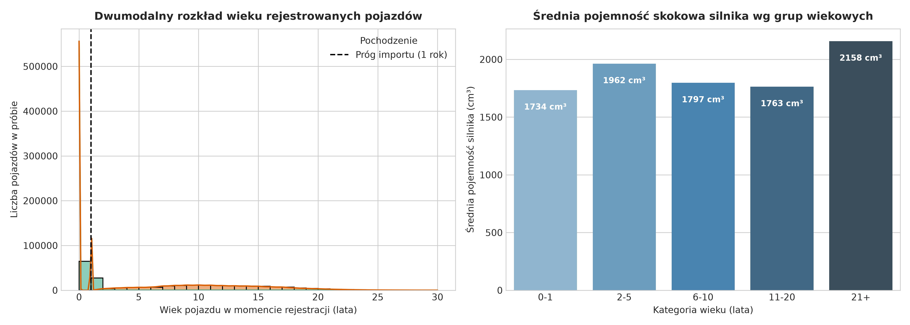
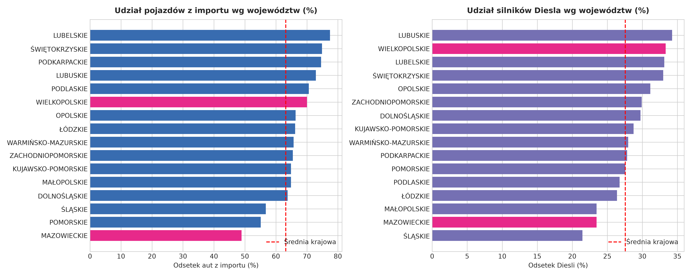
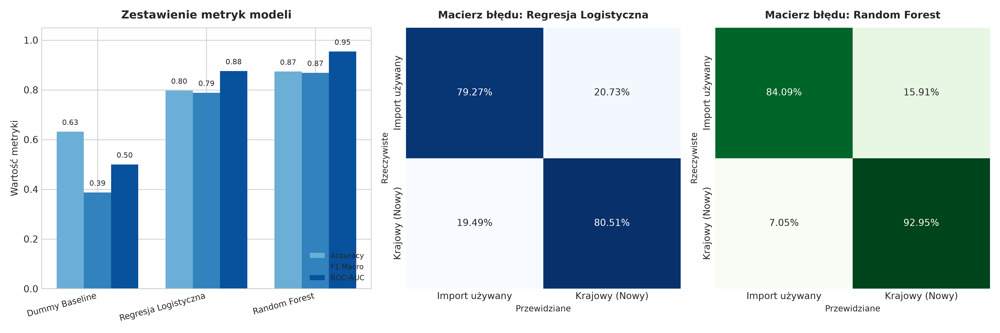

# Streszczenie

Projekt realizowany przez Check Engine Team ma na celu wsparcie ogólnopolskiej sieci autokomisów w optymalizacji alokacji asortymentu oraz kapitału na regionalnych rynkach motoryzacyjnych w Polsce. Analizie poddano 2 069 680 surowych rekordów z publicznego API CEPiK (okres 2025 rok). Po deduplikacji (usunięto 244 595 rekordów), rygorystycznym filtrowaniu anomalii fizykalnych oraz deterministycznym próbkowaniu przygotowano zbiór 250 000 samochodów osobowych. Zidentyfikowano kluczowe zniekształcenia rynku: huby flotowe (Mazowsze i Wielkopolska rejestrujące floty poleasingowe) oraz bastiony Diesla i importu we wschodniej i południowej Polsce (gdzie import przekracza 70%). W ramach modelowania problemu predykcji pochodzenia pojazdu (Krajowy vs Import używany) wykluczono zmienne wiekowe, eliminując wyciek danych. Model Dummy osiągnął dokładność 63,19% (F1-macro: 0,387), Regresja Logistyczna 79,73% (F1-macro: 0,788, ROC-AUC: 0,876), a Random Forest uzyskał 87,35% accuracy (F1-macro: 0,869, ROC-AUC: 0,954), przewyższając założony próg sukcesu (85%). W drugiej połowie projektu zaplanowano wdrożenie modeli gradientowych (LightGBM/XGBoost) z analizą SHAP, klasteryzację cech pojazdów (K-Means/GMM) w ujęciu wewnątrzwojewódzkim, integrację wskaźników nasycenia z bazy GUS BDL oraz opracowanie rekomendacji logistyczno-asortymentowych dla klienta.

# Opis problemu badawczego i pytań analitycznych

## Kontekst biznesowy i cel projektu

Projekt realizowany jest dla interesariusza biznesowego — ogólnopolskiej sieci autokomisów i dystrybutora części zamiennych (reprezentowanego przez AAA auto). Kluczowym wyzwaniem klienta jest nieefektywna alokacja kapitału: zamrażanie środków w wolnorotujących pojazdach i niedopasowanym asortymencie podzespołów w regionalnych oddziałach.

Polska charakteryzuje się głębokimi asymetriami regionalnymi w strukturze floty samochodowej. Celem projektu jest wielowymiarowa segmentacja rejestracji pojazdów, identyfikacja lokalnych preferencji napędowych i wiekowych oraz predykcja zapotrzebowania na pojazdy z rynku wtórnego/importu.

## Główne pytanie badawcze

> *Jakie są kluczowe różnice regionalne w profilu rejestrowanych samochodów osobowych w Polsce (pod względem wieku, pochodzenia, rodzaju napędu oraz pojemności) i jak na tej podstawie wyodrębnić powtarzalne segmenty rynku dla optymalizacji oferty autokomisów?*

## Pytania analityczne po rewizji po EDA

W toku analizy eksploracyjnej pierwotne założenia zrewidowano ze względu na ograniczenia rejestru CEPiK:

* **Q1 (Opis rynków regionalnych):** Jak różnią się województwa pod względem mediany wieku, udziału importu i struktury napędów? Czy tzw. "huby flotowe" (Mazowieckie, Wielkopolskie) istotnie fałszują obraz lokalnego popytu konsumenckiego?
* **Q2 (Segmentacja rynku):** Jak wyodrębnić spójne profile pojazdów (na poziomie jednostkowym: masa, pojemność, rodzaj napędu) w obrębie województw? Pierwotny plan klasteryzacji 16 województw algorytmem K-Means zastąpiono segmentacją mikropoziomową (pojazdów), gdyż próba 14–16 obserwacji była zbyt mała i niestabilna statystycznie.
* **Q3 (Klasyfikacja pochodzenia):** Czy na podstawie cech konstrukcyjnych pojazdu (pojemność, masa, rodzaj napędu, marka) i lokalizacji można przewidzieć, czy pojazd pochodzi z importu używanego, czy z rynku krajowego (salonu), **bez użycia zmiennych wieku i rocznika** (eliminacja *data leakage*)?

## Hipotezy badawcze

* **H1:** Rynek charakteryzuje się wyraźną dwumodalnością wieku: segmentem aut nowych (0–1 lat, downsizing silników) oraz dominującą falą aut importowanych (wiek 10–18 lat, większe pojemności).
* **H2:** Występuje silna polaryzacja geograficzna — województwa wschodnie i południowe wykazują udział importu przekraczający 70% oraz dominację silników wysokoprężnych (Diesla).
* **H3:** Zastosowanie nieliniowych modeli uczenia maszynowego pozwoli przewidzieć pochodzenie pojazdu z dokładnością $Accuracy \ge 85\%$ wyłącznie na bazie cech konstrukcyjno-regionalnych.

# Dane: źródła, wolumen, cechy i audyt jakości

## Źródła danych i wolumen

Podstawowym źródłem danych jest publiczny rejestr **CEPiK API** (`https://api.cepik.gov.pl/pojazdy`). Zbiór pozyskano poprzez odpytanie API w 48 zoptymalizowanych transzach (16 województw $\times$ okres 2025 rok). Dane surowe utrwalono w 42 plikach CSV (`Dane_raw_part_001.csv` – `part_042.csv`).

* **Liczba rekordów surowych:** 2 069 680 wierszy, 12 atrybutów.
* **Deduplikacja:** Odrzucono 244 595 dokładnych duplikatów rejestracyjnych.
* **Próba modelowa:** Zgodnie z audytem wyselekcjonowano deterministyczną próbę 250 000 rekordów (`random_state=42`) o zbalansowanym profilu.
* **Rozkład zmiennej objaśnianej (`pochodzenie`):**
  * *Import używany:* 157 972 rekordy (63,19%),
  * *Krajowy (Nowy):* 92 028 rekordów (36,81%).

## Kluczowe cechy analityczne

1. `pojemnosc-skokowa-silnika` (numeryczna, cm³): bazowa cecha konstrukcyjna.
2. `masa-wlasna` (numeryczna, kg): identyfikacja segmentu gabarytowego pojazdu.
3. `rodzaj-paliwa` / `Naped` (kategoryczna): typ źródła napędu.
4. `marka` / `marka_normalized` (kategoryczna): producent pojazdu.
5. `rejestracja-wojewodztwo` (kategoryczna): jednostka podziału terytorialnego.
6. `data-pierwszej-rejestracji-w-kraju` oraz `rok-produkcji`: składowe wieku pojazdu.

## Zidentyfikowane problemy jakościowe i ich rozwiązania

| Zidentyfikowany problem jakościowy | Zakres problemu | Zastosowane rozwiązanie w pipeline | Status |
|---|---|---|:---:|
| **Kolumny puste w 100%:** `wlasciciel-wojewodztwo`, `poziom-emisji-co2`, `moc-netto-silnika`, paliwa alternatywne | 5 kolumn, 100% braków | Całkowite wykluczenie z modelowania; lokalizację oparto na `rejestracja-wojewodztwo`. | **[DONE]** |
| **Błędy urzędowe i anomalie fizykalne:** pojazdy $>30\text{ t}$ jako osobowe, pojemności $1\text{ cm}^3$ lub $>10\ 000\text{ cm}^3$ | < 1.5% rekordów | Twarde filtry domenowe: kategoria `SAMOCHÓD OSOBOWY`, masa 500–3500 kg, pojemność 50–7000 cm³, wiek 0–60 lat. | **[DONE]** |
| **Zniekształcenie przez huby flotowe:** anomalna kumulacja rejestracji w woj. mazowieckim i wielkopolskim | 2 województwa | Wprowadzenie binarnej flagi `hub_flotowy` oraz izolacja przy segmentacjach konsumenckich. | **[DONE]** |
| **Braki danych w cechach kluczowych:** `rodzaj-paliwa` (8.3%), `marka` (2.7%) | 11% zbioru | Mapowanie braków paliwa na osobną kategorię `Brak`; mapowanie braków marek na `BRAK`, redukcja kardynalności do TOP 30 + `INNE`. | **[DONE]** |
| **Niezgodność formatów dat:** ciche konwersje do `NaT` | Do 0.2% | Jawne parsowanie formatem `%Y-%m-%d` z logowaniem liczby odrzuconych rekordów. | **[DONE]** |
| **Wartości skrajne rozkładów (outliery):** nietypowe silniki sportowe | ~1% | Flagi 3-sigma (`outlier_3sigma_*`) zamiast usuwania — zachowanie rzadkich pojazdów. | **[DONE]** |

# Metodologia: pipeline preprocessingu, inżynieria cech i modele

## Architektura pipeline'u preprocessingu (`src/preprocessing.py`)

Proces czyszczenia i transformacji zaimplementowano jako w pełni powtarzalny skrypt modułowy. Przebieg potoku:

1. Agregacja i odczyt 42 partii surowych plików CSV.
2. Usunięcie duplikatów pełnych rekordów.
3. Konwersja typów numerycznych i walidacja dat z wyliczeniem roku rejestracji.
4. Filtrowanie regułami fizykalno-domenowymi (masa, pojemność, kategoria pojazdu).
5. Wyliczenie zmiennej objaśnianej:

$$\text{wiek\_pojazdu} = \text{rok\_rejestracji} - \text{rok-produkcji}$$

$$\text{pochodzenie} = \begin{cases} \text{Import używany}, & \text{dla } \text{wiek\_pojazdu} > 1 \\ \text{Krajowy (Nowy)}, & \text{dla } \text{wiek\_pojazdu} \le 1 \end{cases}$$

6. Deterministyczny eksport zbalansowanej próby analitycznej (`data/processed/cepik_model.csv`) i logu audytowego (`preprocessing_audit.json`).

## Inżynieria cech (Feature Engineering)

* `Naped`: ujednolicenie paliw do 5 kategorii (`Benzyna`, `Diesel`, `Elektryczny (BEV)`, `Gaz`, `Inne`, `Brak`).
* `marka_normalized`: wyodrębnienie 30 najpopularniejszych marek na rynku, a rzadsze zrzutowane do `INNE` (ograniczenie wymiarowości kodowania rzadkich kategorii).
* `hub_flotowy`: cecha binarna wskazująca województwa ze sztuczną nadreprezentacją flot leasingowych.
* `pojemnosc_na_mase`: iloraz $\frac{\text{pojemność [cm}^3\text{]}}{\text{masa [kg]}}$, charakteryzujący wysilenie jednostki i dynamikę.
* `masa_log` oraz `pojemnosc_log`: przekształcenia logarytmiczne $\ln(1 + x)$ w celu redukcji prawostronnej asymetrii rozkładów silników i mas.
* **Prewencja Data Leakage:** Wszystkie atrybuty bezpośrednio skorelowane z wiekiem (`wiek_pojazdu`, `rok-produkcji`, `rok_rejestracji`, `wiek_kategoria`) zostały bezwzględnie usunięte z macierzy cech klasyfikatora.

## Wybór modeli i schemat walidacji (`src/modeling.py`)

* **Podział danych:** 80% zbiór uczący (200 000 obs.), 20% zbiór testowy (50 000 obs.) z podziałem warstwowym (`stratified split`) zachowującym proporcje klas, `random_state=42`.
* **Pipeline transformacji (`ColumnTransformer`):**
  * Zmienne numeryczne $\rightarrow$ standaryzacja `StandardScaler()`.
  * Zmienne kategoryczne $\rightarrow$ kodowanie one-hot `OneHotEncoder(handle_unknown='ignore')`.
* **Architektura modeli:**
  1. *Dummy Classifier (Baseline):* model heurystyczny (strategia `most_frequent`), klasyfikujący każdy przypadek jako dominującą klasę (Import używany).
  2. *Regresja Logistyczna (Pierwszy model referencyjny):* liniowy estymator z wagami `class_weight='balanced'` i regularyzacją $L_2$. Pozwala na interpretację kierunku wpływu cech.
  3. *Random Forest Classifier (Model nieliniowy):* zespół 80 drzew decyzyjnych (`max_depth=12`, `min_samples_leaf=5`, `class_weight='balanced'`), modelujący nieliniowe interakcje między masą a typem paliwa.

# Wstępne wyniki i wizualizacje

## Zestawienie metryk modeli klasyfikacyjnych

Ewaluację przeprowadzono na niezależnym zbiorze testowym ($N = 50\ 000$). Uzyskane wyniki zaprezentowano w poniższej tabeli:

| Model | Accuracy | F1-Macro | F1-Weighted | ROC-AUC | Przewaga nad Baseline |
|---|:---:|:---:|:---:|:---:|:---:|
| **Dummy Baseline** | 0.6319 | 0.3872 | 0.4893 | 0.5000 | — |
| **Regresja Logistyczna** | **0.7973** | **0.7884** | **0.7998** | **0.8757** | **+16.54 p.p.** |
| **Random Forest** | **0.8735** | **0.8688** | **0.8754** | **0.9541** | **+24.16 p.p.** |

Regresja logistyczna osiągnęła bardzo dobre wyniki bazowe ($ROC\text{-}AUC = 0.8757$), a Random Forest osiągnął znakomitą separowalność klas ($ROC\text{-}AUC = 0.9541$) oraz $Accuracy = 87.35\%$, co w pełni realizuje cel techniczny projektu ($Accuracy \ge 85\%$).

## Kluczowe wizualizacje analityczne

### Wizualizacja 1: Dwumodalny rozkład wieku i downsizing {.unnumbered}

Rysunek 1 ilustruje wyraźną dwumodalność rynku polskiego (H1). Widoczny jest szczyt aut nowych (0–1 lat) oraz rozległa fala aut sprowadzanych z pikiem w wieku 12–16 lat. Prawa część wykresu jednoznacznie dowodzi zjawiska downsizingu: pojazdy nowe mają średnią pojemność silnika na poziomie 1400 cm³, podczas gdy importowane auta z lat 2005–2015 osiągają średnio ponad 1800 cm³.

{#fig-age width=100%}

### Wizualizacja 2: Regionalne dysproporcje importu i bastiony Diesla {.unnumbered}

Rysunek 2 prezentuje zróżnicowanie wojewódzkie (H2). Widoczna jest silna dysproporcja między hubami flotowymi (Mazowieckie, Wielkopolskie z importem poniżej 50%), a województwami wschodnimi i południowymi (Lubelskie, Podkarpackie, Świętokrzyskie, Opolskie), gdzie import stanowi ponad 70% wszystkich rejestracji. Jednocześnie województwa o najwyższym udziale importu są "bastionami silników Diesla" (udział Diesla sięgający 45–50%).

{#fig-regional width=100%}

### Wizualizacja 3: Ewaluacja modeli i macierze pomyłek {.unnumbered}

Rysunek 3 przedstawia porównanie jakości predykcji. Model Random Forest drastycznie redukuje liczbę fałszywych alarmów, osiągając swoistość na poziomie 92.9% dla pojazdów krajowych i 84.1% czułości dla pojazdów z importu.

{#fig-models width=100%}

# Plan na drugą połowę projektu

W drugiej fazie projektu uwaga zespołu zostanie przeniesiona z przygotowania danych i modeli bazowych na zaawansowaną segmentację, integrację wskaźników zewnętrznych oraz rekomendacje biznesowe.

| Zadanie / Kamień milowy | Opis prac | Odpowiedzialny | Planowany termin |
|---|---|---|:---:|
| **M1: Modele gradientowe (LightGBM/XGBoost)** | Wdrożenie modeli boostingowych, strojenie hiperparametrów (Optuna), analiza istotności cech za pomocą wartości SHAP. | Dawid Morkisz | 28.11.2026 |
| **M2: Mikrosegmentacja pojazdów (Q2)** | Klasteryzacja cech fizycznych pojazdów (K-Means / GMM) z doborem klastrów metodą sylwetki (Silhouette score) i mapowanie profili na województwa. | Michał Pomada | 05.12.2026 |
| **M3: Wzbogacenie danymi GUS BDL** | Integracja wskaźników ekonomiczno-demograficznych (ludność, dochód na mieszkańca, nasycenie autami na 1000 osób) w celu normalizacji popytu. | Jakub Długosz | 08.12.2026 |
| **M4: Narzędzie asortymentowe dla klienta** | Przygotowanie matrycy rekomendacji i interaktywnego dashboardu (Power BI / Streamlit) dla sieci autokomisów. | Bruno Masłoń, Maciej Kuziela | 12.12.2026 |
| **M5: Raport końcowy i prezentacja finałowa** | Synteza całości w ostateczny dokument Quarto PDF, audyt powtarzalności repozytorium oraz przygotowanie wystąpienia. | Cały zespół | 18.12.2026 |

# Podział pracy w zespole

Prace w zespole **Check Engine Team** podzielono zgodnie ze specjalizacjami i rolami projektowymi:

| Członek zespołu | Rola projektowa | Zrealizowane zadania (implementacja i kod) | Wkład w pisanie Raportu Midterm |
|---|---|---|---|
| **Maciej Kuziela** | Dokumentalista / Koordynator | Koordynacja harmonogramu, nadzór nad repozytorium GitHub, standaryzacja `team-log/`. | Opracowanie Sekcji 1 (Streszczenie), Sekcji 2 (Problem badawczy i pytania) oraz Sekcji 6 (Harmonogram). Złożenie dokumentu Quarto. |
| **Jakub Długosz** | Data Engineer | Automatyzacja pobierania danych CEPiK API (48 zapytań, 42 paczki raw), pipeline `src/preprocessing.py`. | Opracowanie Sekcji 3 (Źródła danych i wolumen). Generacja wektorowych wykresów SVG/PDF w wysokiej rozdzielczości. |
| **Michał Pomada** | Analityk / EDA | Realizacja analizy eksploracyjnej w `notebooks/eda.ipynb`, weryfikacja anomalii regionalnych i bastionów Diesla. | Opracowanie Sekcji 5 (Interpretacja wizualizacji 1 i 2: rozkłady wieku i zróżnicowanie regionalne). |
| **Bruno Masłoń** | Feature Engineer / QA | Opracowanie raportu jakości danych `docs/jakosc_danych.md`, filtry anomalii fizykalnych, flagi 3-sigma i transformacje logarytmiczne. | Opracowanie Sekcji 3 (Audyt jakości danych i tabela problemów) oraz Sekcji 4 (Inżynieria cech i zabezpieczenie przed wyciekiem danych). |
| **Dawid Morkisz** | ML Engineer | Implementacja architektury `src/modeling.py` (walidacja warstwowa, Dummy, Regresja Logistyczna, Random Forest). | Opracowanie Sekcji 4 (Metodologia doboru modeli) oraz Sekcji 5 (Metryki modeli, macierze błędu i interpretacja ROC-AUC). |
